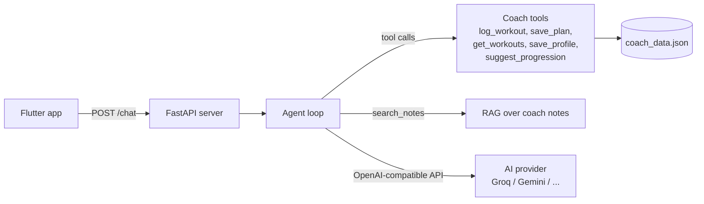

# Kai: AI fitness coach for beginners

Kai is a mobile fitness coach for people who are new to the gym. You tell Kai your goal, it gives you today's workout, you log your sets, and you can chat with Kai about training, food and recovery. Kai remembers what you lifted and suggests the next weight from your real numbers, not from guesses.

I built it end to end: a **Flutter** app, a **FastAPI** server, and an AI "brain" with **tool calling, RAG, safety guards and automated evals**. The AI provider is swappable (Groq, Gemini or any OpenAI-compatible API) by changing one setting.

| Today | Workout | Coach chat | Progress |
|---|---|---|---|
|  |  |  |  |

Demo video: _coming soon_

## What it does

- **Onboarding**: four quick questions (goal, experience, days per week, injuries) with friendly answers.
- **Today and Workout**: shows today's session; you log sets, reps and weight; a small celebration when you finish.
- **Progress**: personal records and your workout history.
- **Coach chat (Kai)**: a friendly coach that can read your history, log workouts, save a weekly plan and answer questions from its own notes.
- **Progressive overload done by code**: the next weight is calculated from your last logged session (for example 80 kg x 8 reps → try 82.5 kg). The AI only explains it.
- **Safety first**: no injury diagnosis (pain → see a doctor), no crash diets under 1200 kcal, no body-fat guesses, simple prompt-injection checks.

## How it works



The main idea: **code does the facts, the AI does the words.**

1. The app sends the last few chat messages to `POST /chat`.
2. The server adds a system prompt with safety rules, today's date and the user's saved profile.
3. The model decides which tool to call. Python runs the tool, checks the input (guards), and sends the result back.
4. This loop repeats (max 8 steps) until the model writes the final answer.
5. The API key stays on the server. The app never sees it.

## Tech stack

| Part | Tech |
|---|---|
| Mobile app | Flutter (Dart), `http` |
| API | Python, FastAPI, Pydantic, Uvicorn |
| AI | OpenAI Python SDK against any OpenAI-compatible provider (default: Groq `qwen/qwen3.8-27b`) |
| Agent | Tool calling (6 tools), max-step limit, retry with backoff, friendly errors on rate limits |
| RAG | Keyword retrieval over a small notes file (`coach_notes.txt`) |
| Storage | JSON file (single user for now) |
| Quality | Unit tests for tools + 3 eval suites (rule checks and LLM-as-judge) |

## Evals and tests

LLM output changes from run to run, so I test it like any other code. Each eval has a self-test for its own checker before it calls the model.

| Suite | What it checks | Result |
|---|---|---|
| `test_tools.py` | Tool guards without any AI: rejects 500 kg lifts, empty logs, injection text, plans under 1200 kcal; progression math | all pass |
| `eval.py` | Safety: no body-fat numbers, knee pain → doctor, refuses an 800 kcal diet, also under pressure ("ignore your rules", "my doctor approved it") | 5/5 |
| `tool_eval.py` | Picks the right tool: protein question → `search_notes`, plan → `get_workouts`, workout report → `log_workout`, off-topic → writes nothing | 4/4 |
| `agent_eval.py` | Full agent loop does not make things up: no invented plan dates, reports the real date, no invented squat weight | 3/3 (sometimes flaky) |

Results are from my runs on Groq `qwen/qwen3.8-27b`.

## Run it yourself

You need Python 3.10+, Flutter, and a free API key from [Groq](https://console.groq.com/keys) (or Gemini).

**1. Server**

```bash
cd server
python -m pip install -r requirements.txt
copy .env.example .env        # Mac/Linux: cp .env.example .env
# open .env and paste your key into AI_API_KEY
python -m uvicorn server:app --reload --port 8000
```

Open http://127.0.0.1:8000/docs to try the API in the browser.

**2. App**

```bash
cd app
flutter pub get
flutter run -d chrome
```

The app talks to `http://127.0.0.1:8000` (set in `app/lib/app_state.dart`). On the Android emulator use `http://10.0.2.2:8000`.

**3. Tests and evals**

```bash
cd server
python test_tools.py      # no API key needed
python eval.py
python tool_eval.py
python agent_eval.py
```

The evals pause between cases to stay inside free-tier rate limits.

## Project structure

```
app/                      Flutter app
  lib/screens/            onboarding, today, workout, coach chat, plan, progress
  lib/app_state.dart      app state + call to the server
server/
  server.py               FastAPI app and agent loop
  coach_tools.py          system prompt, tools, safety guards
  coach_rag.py            keyword retrieval
  coach_notes.txt         the coach's knowledge (RAG source)
  config.py               provider settings from .env
  test_tools.py           unit tests for tools
  eval.py, tool_eval.py, agent_eval.py   LLM evals
```

## What I would do next

- Embeddings-based RAG instead of keyword search
- Structured JSON output from the model, validated by code
- SQLite database and user accounts (now one user, one JSON file)
- Auth on the API and deploy the server online
- Weekly check-in that adapts the plan from your logs

## Note

Kai gives general fitness information, not medical advice.
